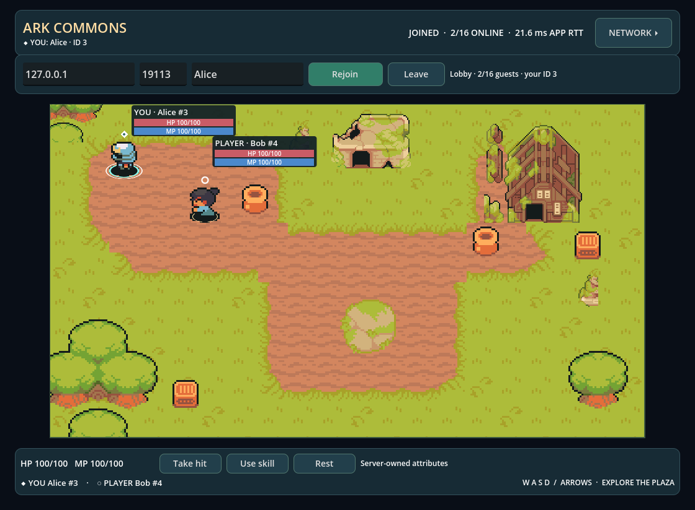

<p align="right">简体中文 · <a href="README.md">English</a></p>

<p align="center">
  <picture>
    <source media="(prefers-color-scheme: dark)" srcset="https://raw.githubusercontent.com/OpenArkStudio/.github/main/assets/ark-logo-dark.svg?v=20261022">
    
  </picture>
  <picture>
    <source media="(prefers-color-scheme: dark)" srcset="docs/images/godot/logo-dark.svg">
    
  </picture>
</p>

<h3 align="center">基于 Godot 与 C# 的 ark 客户端演示。</h3>

<p align="center">进入共享房间，一起移动，观察数据同步。</p>

<p align="center">
  <a href="https://github.com/OpenArkStudio/ark-client-godot/actions/workflows/ci.yml"></a>
  <a href="project.godot"></a>
  <a href="Ark.Client.Godot.csproj"></a>
  <a href="LICENSE"></a>
</p>

<p align="center"><a href="docs/run_CN.md"><strong>开始使用 →</strong></a> &nbsp; · &nbsp; <a href="docs/data-sync_CN.md">数据同步</a> &nbsp; · &nbsp; <a href="https://github.com/OpenArkStudio/ark/tree/main/examples/guest_room">服务端示例</a> &nbsp; · &nbsp; <a href="docs/validation_CN.md">验收记录</a></p>

---

## 功能

- **共享房间**：进入像素风格村庄，与其他访客相互可见，通过 WASD 或方向键移动。
- **实体属性**：通过 HP/MP 操作和数值条，观察服务端维护的状态与确认后的属性变化。
- **玩家身份**：使用 YOU/PLAYER 标签与不同的地面标记，区分自己和其他玩家。
- **网络可视化**：查看 RTT、消息统计、提议与确认位置，对比平滑显示和原始快照，并体验断线重连。



## 开始使用

需要准备：

- **Godot 4.7.2 .NET**：标准版编辑器无法运行此 C# 项目。
- **.NET 8 SDK**。
- 配套的 ark [`guest_room` 服务端](https://github.com/OpenArkStudio/ark/tree/main/examples/guest_room)，按当前配套示例构建并监听 `127.0.0.1:19100`。请先按其说明启动，无需数据库或 Registry 服务。

克隆并构建：

```sh
git clone https://github.com/OpenArkStudio/ark-client-godot.git
cd ark-client-godot
bash tools/build.sh
```

将 `godot` 指向 Godot .NET 可执行文件，在两个终端中分别启动 Alice 和 Bob：

```sh
# 终端 1
godot --path . -- --host=127.0.0.1 --port=19100 --name=Alice --connect
```

```sh
# 终端 2
godot --path . -- --host=127.0.0.1 --port=19100 --name=Bob --connect
```

便携工具链设置与故障排查见[运行指南](docs/run_CN.md)。

## 体验演示

| 操作 | 效果 |
| --- | --- |
| WASD / 方向键 | 移动角色；两个客户端均显示服务端确认的位置 |
| **Take hit** / **Use skill** / **Rest** | HP 减少 15 / 消耗 20 MP / HP 与 MP 各恢复 20，由服务端校验上下限 |
| **Leave** → **Connect**，或 **Rejoin** | 以新访客身份加入，初始 HP/MP 均为 100 |
| **NETWORK** / **Visual smoothing** | 查看同步信息，对比原始位置与平滑显示 |

客户端提议动作，由 ark 确定最终位置和属性。意外断线后最多重试五次，重新连接会创建新的访客状态。示例提供 16 个访客名额，不包含账号、持久化、加密与 Web 导出，也不代表生产容量验收。

[数据流程](docs/data-sync_CN.md) · [协议](docs/protocol_CN.md) · [测试](docs/validation_CN.md) · [参与贡献](AGENTS.md) · [素材署名](docs/third-party-notices_CN.md)

---

[Apache-2.0](LICENSE) · [CC0 Ninja Adventure 素材](docs/third-party-notices_CN.md) · [OpenArkStudio](https://github.com/OpenArkStudio)
