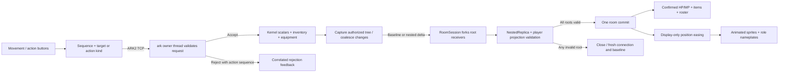

# Observe the network and data flow

The client proposes movement and business actions. ark validates them on its
owner thread, changes Kernel-owned scalars, inventory rows and equipment children,
then publishes an authorized Entity tree. New connections install a complete
Protobuf baseline; existing peers receive added baselines, nested deltas and root
tombstones. `NestedReplica` validates each root against its trusted layout;
`RoomSession` commits the whole room envelope only after every root and player
projection succeeds. Reconnect installs fresh state; revision gaps close the
connection. Both peers must be rebuilt for the current [protocol](protocol.md).

| Entity member | What the demo makes visible |
| --- | --- |
| `GuestPlayer` scalar fields | Position, HP/MP, move and action sequences |
| Inventory table 200, row 1 | Start with two potions; drinking patches quantity, removes the last row, and pickup reuses row 1 with a newer incarnation |
| Equipment container 300, slot 1 | Switch Blade/Staff by replacing membership; strengthen the current child through a field patch; switching back preserves that child's identity and power |

The generic receiver preserves all nine scalar alternatives and owning byte
values. A complete authorized snapshot includes empty selected tables/containers.
Rows carry lifetimes, and container patches preserve child GUID/incarnation;
history watermarks reject stale reuse. Receiver forks isolate both state and
history until the room commits. A rejected peer cannot partially confirm your
action or change your items. [Wire rules and limits](protocol.md) define these
checks separately from the sample's fixed inventory/equipment layout.

The compact connection card selects the host, port and guest name. YOU text,
a diamond and double ground ring identify the local ninja; PLAYER text and hollow
markers identify peers independently of color. The 960×540 village plaza is the
main view. NETWORK opens the full roster, server coordinates and diagnostics.
The logical canvas scales while retaining the full playfield. Names remain
complete in state even when visible labels use ellipsis. Art credit and licensing
are recorded in [third-party notices](third-party-notices.md); props add no collision rules.

The **Visual smoothing** toggle controls display-only exponential easing toward
the latest received coordinates. New IDs start at their received position;
removed IDs disappear; reconnect clears all display state. The outlined ring
is a display identity marker; separate raw-server markers are off by default and
can be enabled in NETWORK. Sprite facing and 6 fps walking advance only while
the displayed position actually moves. This is not client prediction, rollback,
extrapolation or interpolation through a time-buffered snapshot history.
`RoomSession` and the server-confirmed sequence/coordinates stay unchanged by
smoothing.

Expand **NETWORK** to compare actual observations:

| Field | Meaning |
| --- | --- |
| TCP peer | Resolved remote endpoint of the current connection; absent before connect |
| Entity GUID | Actual positive Kernel entity identity, distinct from the logical decimal player ID and replaced on rejoin |
| Move proposal | Latest generated move sequence and target, before server confirmation |
| Server-confirmed | This player's sequence and coordinates in the committed baseline plus deltas |
| HP / MP and maxima | Required server-owned values; bars and numbers update only from a valid complete room envelope |
| Inventory / equipment | Confirmed item quantity, equipped weapon and power; item tooltips show row or child lifetime/identity |
| Baselines / deltas | Committed room envelopes; one full baseline on join, then changes rather than routine full-room broadcasts |
| Action proposal / pending / action_seq | A separate sequence from movement. Only own matching/newer confirmed `action_seq` resolves acceptance; an exact correlated error resolves rejection without leaving |
| Last room update age | Monotonic elapsed time since this client applied the latest valid committed room update; not server generation age or one-way latency |
| App ping RTT | Monotonic time from beginning the ping send call to processing its matching pong on the client owner thread; includes local sends, network transit, server queues/polling and client receive queues/polling |
| Ping / pong nonce | Current pending nonce and last matched nonce; stale or duplicate pongs do not create a new RTT sample |
| Tx completed frames / bytes | Complete application-frame writes accepted by the local stream, including the 12-byte header; no peer receipt/ACK claim, and no estimate of partial failed writes |
| Rx decoded frames | Valid complete ARK2 frames parsed from the stream |
| Rx stream bytes | Actual stream-read bytes, including headers, incomplete data and invalid framing; excludes TCP/IP overhead |

A ping starts after the initial baseline and repeats every five seconds.
Each connection permits only one in-flight local stream write. A busy connection
defers movement and heartbeat preparation before consuming a sequence, nonce or
deadline; an action click reports nonfatal busy feedback without creating a
pending action. There is no additional send queue and no peer-ACK inference.
Unavailable observations show an em dash rather than fabricated zero latency.
Transport counters belong to one `TcpConnection`; a new instance starts at zero.
Disconnect/rejoin clears proposals, age, pending nonce, RTT and display state.
It also clears pending business actions without retry. New guests receive
100 HP/MP, two potions and an initial Blade. Clicking an attribute or item action
does not anticipate its result: quantity, icons, power and HP/MP stay at the last
committed values until the server confirms a change. Drinking at full HP still
consumes a potion; an empty inventory rejects the request nonfatally. Floating HP/MP amounts compare committed
room states, so a capped no-op creates no fabricated increase/decrease. HP zero
does not disable demo movement. Action requests contain no amount, item value or target Entity.
Counter snapshots are immutable and protected by a short transport lock; room,
RTT and presentation state are mutated only on the client owner thread.

There is no latency/loss simulation. Application RTT, byte totals and visible
smoothing do not establish TCP throughput, packet loss, production capacity or
cross-host performance.

The room-update age naturally grows while everyone is idle because room updates
are event-driven. It does not trigger a connection failure; the actual matching
ping/pong deadline checks health. The metrics text refreshes at about 5 Hz while
avatars update on every display frame.
