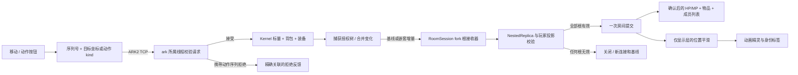

# 观察网络与数据同步流程

客户端提议移动与业务动作。ark 在所属线程校验请求，修改 Kernel 管理的标量、背包行与装备子实体，
再发布授权 Entity 树。新连接安装完整 Protobuf 基线；已有成员接收新增基线、嵌套增量与根墓碑。
`NestedReplica` 按可信布局校验每个根；全部根及玩家投影成功后，`RoomSession` 才提交整个房间消息。
重连安装全新状态，修订缺口关闭连接。使用当前[协议](protocol_CN.md)须同时重新构建两端。

| Entity 成员 | 演示中可观察的变化 |
| --- | --- |
| `GuestPlayer` 标量字段 | 位置、HP/MP、移动与动作序列 |
| 背包表 200，行 1 | 初始两瓶药水；喝药修改数量、耗尽删除行；pickup 用更大 incarnation 重新分配行 1 |
| 装备容器 300，槽位 1 | 切换 Blade/Staff 替换成员集合；强化为当前子实体字段补丁；切回保留原有子实体身份与 power |

通用接收器保留九种标量分支与拥有数据的字节值。完整授权快照包含选中的空表／容器。
行携带生命周期，容器补丁保留子 GUID／incarnation，历史水位拒绝过期复用。
接收器 fork 在房间提交前隔离状态与历史，无效的其他成员不能部分确认自己的动作或改变物品。
[协议规则与限额](protocol_CN.md)将这些校验与示例固定背包／装备布局分开说明。

紧凑连接卡片提供主机、端口和访客名字输入。本地忍者由 YOU 文字、菱形和双地面环标识；
其他成员由 PLAYER 文字和空心标记标识，不仅依赖颜色。960×540 村庄广场是主视图。
NETWORK 展开完整成员列表、服务端坐标和诊断。逻辑画布随窗口缩放并保留完整场地。
可见标签省略长名字时，状态仍保留完整名字。[第三方声明](third-party-notices_CN.md) 记录素材署名及许可证；装饰不增加碰撞规则。

**Visual smoothing** 开关控制仅显示层的指数趋近，目标为最近收到的坐标。
新 ID 从收到的位置开始显示；移除的 ID 立即消失；重连清空显示状态。
地面环用于显示身份；独立的原始服务端标记默认关闭，可在 NETWORK 开启。
精灵朝向和每秒 6 帧的行走动画，仅在显示位置实际变化时更新。这不属于客户端预测、回滚、外推，
也不属于基于历史快照时间缓冲的插值。平滑不改变 `RoomSession`、服务端确认的序列号或坐标。

展开 **NETWORK** 可比较实际观测值：

| 字段 | 含义 |
| --- | --- |
| TCP peer | 当前连接解析后的远端地址；连接建立前为空 |
| Entity GUID | 实际 Kernel 正实体身份，与十进制逻辑玩家 ID 分开，重新加入时替换 |
| Move proposal | 最近生成的移动序列号与目标坐标，此时尚不能视为服务端确认 |
| Server-confirmed | 已提交的基线与增量中，本玩家的序列号与坐标 |
| HP / MP 与上限 | 必须存在的服务端属性；条和数值仅随完整且有效的房间消息更新 |
| 背包 / 装备 | 确认后的物品数量、当前武器和 power；物品提示显示行或子实体的生命周期／身份 |
| Baselines / deltas | 已提交房间消息；入房一次完整基线，之后传变化，普通更新不广播完整房间 |
| 动作提议 / 待确认 / action_seq | 与移动独立的序列号。自己的匹配或更新 `action_seq` 确认接受；精确关联的错误确认拒绝，不离开房间 |
| Last room update age | 从本客户端应用最近有效房间状态更新起的单调时钟耗时；不代表服务端快照生成时间或单向延迟 |
| App ping RTT | 从开始调用 ping 发送，到客户端所属线程处理匹配 pong 的单调时钟耗时；包括本地发送、网络传输、服务端队列与轮询，以及客户端接收队列与轮询 |
| Ping / pong nonce | 当前待匹配 nonce 和最近匹配 nonce；旧 pong 或重复 pong 不产生新 RTT 样本 |
| Tx completed frames / bytes | 本地流完成写入的完整应用消息帧及字节数，包含 12 字节消息头；不代表对端收到或确认，也不估计失败写入的部分字节 |
| Rx decoded frames | 从字节流中解析出的有效完整 ARK2 消息帧 |
| Rx stream bytes | 实际读取的流字节数，包含消息头、不完整数据和无效帧数据，不包含 TCP/IP 开销 |

客户端在初始基线后发送 ping，此后每 5 秒发送一次。尚无观测值时显示破折号，不填造零延迟。
传输计数属于一个 `TcpConnection`；新实例从零开始。断开或重新加入时，
清空提议、快照年龄、待匹配 nonce、RTT 与显示状态。
待确认业务动作也会清空，且不重试。新访客获得 100 HP/MP、两瓶药水和初始 Blade。
点击属性或物品动作不会预先修改结果：数量、图标、power 与 HP/MP 保留最近提交值，直到服务端确认变化。
满血喝药仍消耗一瓶；空背包时拒绝请求并保留连接。浮动 HP/MP 数值来自已提交房间状态之间的差值，
因此上限裁剪后没有变化的动作不会制造增减反馈。HP 为零仍允许示例移动。
动作请求不包含数值、物品值或目标 Entity。
计数快照不可变，传输层通过短时锁保护；房间、RTT 和显示状态仅由客户端所属线程修改。

每个连接同一时间只允许一次本地流写入。连接忙时，在消耗序列号、nonce 或截止时间之前，
延后移动与心跳的准备；动作按钮显示非致命的忙碌反馈，不生成待确认动作。
不增加发送队列，也不据此推断对端 ACK。

本示例不模拟延迟或丢包。应用 RTT、累计字节数与可见平滑不能证明 TCP 吞吐量、丢包率、
生产容量或跨主机性能。

成员全部静止时，距最近房间状态更新的时间会自然增加，因为房间更新由事件触发。
这个数值不会导致连接失败；连接健康由真实 ping/pong 匹配的截止时间检查。
观测文字约每秒刷新 5 次，角色显示则逐帧更新。
