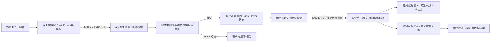

# 观察网络与数据同步流程

客户端提出目标坐标和严格递增的移动序列号。ark 示例在所属线程上检查序列号与房间边界，
更新 Kernel 管理的玩家实体，再广播完整房间快照。两个客户端分别根据收到的快照更新
自身的权威 `RoomSession`。加入、接受移动和成员断线触发快照；这里不是固定频率的快照流。

顶部连接卡片提供主机、端口和访客名字输入。青色标识本地访客，琥珀色标识其他成员。
成员列表展示服务端 ID、坐标和序列号。960×540 场地与可滚动侧栏分开。
逻辑画布随窗口缩放，同时保留完整场地。可见标签省略长名字时，状态仍保留完整名字。

**Visual smoothing** 开关控制仅显示层的指数趋近，目标为最近收到的坐标。
新 ID 从收到的位置开始显示；移除的 ID 立即消失；重连清空显示状态。
轮廓圆环始终标记原始服务端位置。这不属于客户端预测、回滚、外推，
也不属于基于历史快照时间缓冲的插值。平滑不改变 `RoomSession`、服务端确认的序列号或坐标。

展开 **Show network details** 可比较实际观测值：

| 字段 | 含义 |
| --- | --- |
| TCP peer | 当前连接解析后的远端地址；连接建立前为空 |
| Entity ID | 服务端返回的临时不透明 ID，重新加入时替换 |
| Move proposal | 最近生成的移动序列号与目标坐标，此时尚不能视为服务端确认 |
| Server-confirmed | 最近应用的完整快照中，本玩家的序列号与坐标 |
| Last room update age | 从本客户端应用最近有效快照起的单调时钟耗时；不代表服务端快照生成时间或单向延迟 |
| App ping RTT | 从开始调用 ping 发送，到客户端所属线程处理匹配 pong 的单调时钟耗时；包括本地发送、网络传输、服务端队列与轮询，以及客户端接收队列与轮询 |
| Ping / pong nonce | 当前待匹配 nonce 和最近匹配 nonce；旧 pong 或重复 pong 不产生新 RTT 样本 |
| Tx completed frames / bytes | 本地流完成写入的完整应用消息帧及字节数，包含 12 字节消息头；不代表对端收到或确认，也不估计失败写入的部分字节 |
| Rx decoded frames | 从字节流中解析出的有效完整 ARK1 消息帧 |
| Rx stream bytes | 实际读取的流字节数，包含消息头、不完整数据和无效帧数据，不包含 TCP/IP 开销 |

客户端在初始快照后发送 ping，此后每 5 秒发送一次。尚无观测值时显示破折号，不填造零延迟。
传输计数属于一个 `TcpConnection`；新实例从零开始。断开或重新加入时，
清空提议、快照年龄、待匹配 nonce、RTT 与显示状态。
计数快照不可变，传输层通过短时锁保护；房间、RTT 和显示状态仅由客户端所属线程修改。

本示例不模拟延迟或丢包。应用 RTT、累计字节数与可见平滑不能证明 TCP 吞吐量、丢包率、
生产容量或跨主机性能。

成员全部静止时，距最近房间状态更新的时间会自然增加，因为快照由事件触发。
这个数值不会导致连接失败；连接健康由真实 ping/pong 匹配的截止时间检查。
观测文字约每秒刷新 5 次，角色显示则逐帧更新。
